<h1 align="center">
  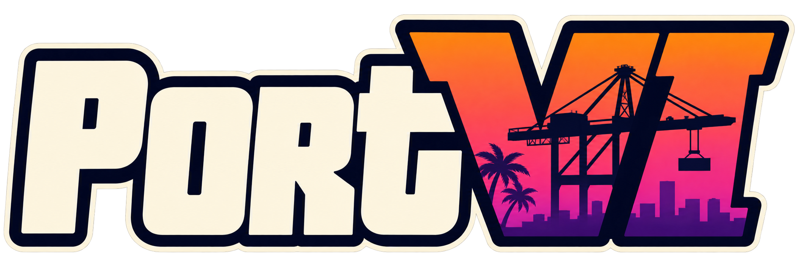
</h1>

<p align="center"><strong>VIctory on the desktop GeForce RTX 4060 · 8 GB</strong></p>

<p align="center">
  <a href="https://github.com/tyr0nsur/PortVI/actions/workflows/windows.yml"></a>
  <a href="#build-and-run"></a>
  <a href="https://github.com/tyr0nsur/PortVI/issues"></a>
  <a href="LICENSE"></a>
</p>

<p align="center">
  <a href="https://portvi-runtime.round-gnat-8815.chatgpt.site/">Project site</a> ·
  <a href="#roadmap">Roadmap</a> ·
  <a href="docs/project-status.md">Project status</a> ·
  <a href="#development-dashboard">Dashboard</a> ·
  <a href="#build-and-run">Build and run</a> ·
  <a href="#contribute">Contribute</a> ·
  <a href="docs/engineering-review.md">Engineering notes</a>
</p>

PortVI is a community compatibility project built on Marvisak’s VIctory. Our long-term goal is to make Grand Theft Auto VI playable on most current Windows PCs. The desktop GeForce RTX 4060 with 8 GB of VRAM is our first reference configuration. [Upstream engine](https://github.com/Marvisak/VIctory)

## Roadmap

**Stabilize PortVI.** Our first visual milestone is a reproducible in-game view with geometry, materials, full-detail textures and ray-traced lighting visible. We use the console as the visual reference and are targeting 30 rendered frames per second at 1080p in the same scene. [1080p rendering milestone](https://github.com/tyr0nsur/PortVI/issues/26)

**Start SixM.** We plan to begin multiplayer development once PortVI reaches a stable gameplay baseline. The SixM repository is already open to contributors who want to propose designs, prepare test fixtures or join the effort. [SixM repository](https://github.com/tyr0nsur/SixM)

**What runs today.** On the RTX 4060, PortVI has verified high-index resource bindings and 64-bit ray-intersection tests. Earlier scene captures showed partial geometry. A recent experimental build ran for 110 seconds after entering the scene, but its captures showed subtitles on black. The RTX 4060 has since created all nine previously refused ray-builder pipelines with Castyan’s candidate translator. Scene lighting still needs verification in PortVI. [Resource bindings](https://github.com/tyr0nsur/PortVI/pull/23) · [Ray-intersection tests](https://github.com/tyr0nsur/PortVI/pull/22) · [Scene result](https://github.com/tyr0nsur/PortVI/pull/24) · [Candidate hardware results](https://github.com/tyr0nsur/PortVI/issues/26#issuecomment-7226052967)

**Help bring up the lighting.** Shader developers can adapt a 64-lane operation and check the values written by the GPU. GeForce owners can run a source-built texture fixture and compare their result with the reference card. We work in English and Spanish. [Pick a task](https://github.com/tyr0nsur/PortVI/issues/26) · [Run your first hardware check](CONTRIBUTING.md#run-a-hardware-check)

## Development dashboard

The cards show the results of individual tests. The mesh draw checks all four color channels of a 16×16 target. The texture tests use an 8×4 BC4 image.

<!-- verification:start -->
<p align="center">
  <a href="tests/fixtures/portvi-smoke.rs">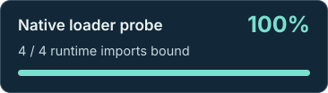</a>
  <a href="docs/engineering-review.md#component-tests">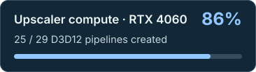</a>
  <a href="docs/engineering-review.md#wave64-on-a-32-lane-gpu">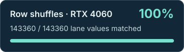</a>
  <a href="docs/engineering-review.md#bcpack-entropy">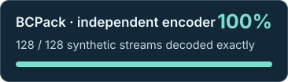</a>
  <a href="docs/engineering-review.md#reproduced-on-this-revision">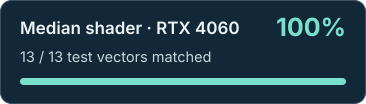</a>
  <a href="docs/engineering-review.md#loop-carried-masks-and-scalar-joins">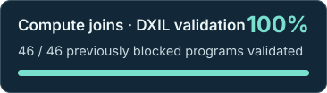</a>
  <a href="docs/engineering-review.md#loop-carried-masks-and-scalar-joins">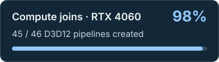</a>
  <a href="docs/engineering-review.md#descriptor-words-as-shader-data">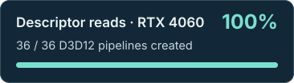</a>
  <a href="docs/engineering-review.md#descriptor-words-as-shader-data">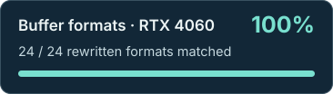</a>
  <a href="docs/engineering-review.md#floating-point-conversion">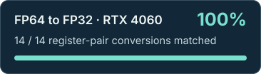</a>
  <a href="docs/engineering-review.md#linked-mesh-and-pixel-shaders"></a>
  <a href="docs/engineering-review.md#bc4-storage-and-gpu-readback"></a>
  <a href="docs/engineering-review.md#bc4-storage-and-gpu-readback">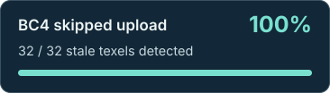</a>
  <a href="https://github.com/tyr0nsur/PortVI/issues/1">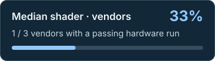</a>
  <a href="https://github.com/tyr0nsur/PortVI/issues/3">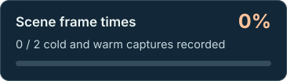</a>
</p>
<!-- verification:end -->

**Windows regression run** · On Windows x64, 885 distinct Rust workspace tests and two frame-time analyzer tests passed. A source-built x64 probe bound four imports, allocated and freed a Windows Automation string containing an embedded zero, and returned 73. [Test breakdown](docs/engineering-review.md#reproduced-on-this-revision)

**Component tests** · Microsoft’s validator accepted 26 of 29 compute shaders from an upscaler library. The RTX 4060 created 25 pipelines, up from 24. PortVI also resolved all 611 distinct static imports across 16 local libraries. [Before and after](docs/engineering-review.md#component-tests)

**Texture decoding** · PortVI now decodes all 128 synthetic streams from Ahmet Dedeler’s bcpack-rs encoder. All 126,336 entropy symbols matched the generator. [Reproduction and two-block interoperability case](docs/engineering-review.md#bcpack-entropy)

**Compute shaders** · All 46 programs blocked by loop or branch masks now pass Microsoft’s DXIL validator. The RTX 4060 created 45 of their D3D12 pipelines. The remaining program requests a 64-lane wave. [Before-and-after results and GPU tests](docs/engineering-review.md#loop-carried-masks-and-scalar-joins)

**Descriptor reads** · The RTX 4060 created pipelines for all 35 pixel shaders and one compute shader previously blocked on descriptor reads. In a separate test, the RTX 4060 and WARP each read the correct address, element count and format for all 24 rewritten buffer views. [Results and runnable tests](docs/engineering-review.md#descriptor-words-as-shader-data)

**Texture streaming** · A DirectStorage request decoded two BC4 blocks directly into a console texture. The RTX 4060 matched all 32 texels after upload and detected all 32 stale texels when the upload was deliberately skipped. [Run the fixture](docs/engineering-review.md#bc4-storage-and-gpu-readback)

**Texture sampling** · The translator now emits DXIL for two instructions with 16-bit texture gradients. The RTX 4060 and WARP selected the expected mip levels and texels with both 16-bit and 32-bit coordinates. [G16 tests and supported forms](docs/engineering-review.md#g16-texture-sampling)

**Mesh rendering** · When a mesh shader exceeds the Direct3D 12 output limit, PortVI checks which channels its pixel shader reads. An authored draw went from 34,816 to 4,096 output bytes and reproduced the expected color in all 256 pixels. [Linked shader tests](docs/engineering-review.md#linked-mesh-and-pixel-shaders)

**Frame pacing** · The first scene benchmark needs paired 120-second captures with cold and warm caches. Stable 30 FPS remains unmeasured. [Capture protocol](docs/engineering-review.md#measuring-a-30-fps-target)

**Direct3D 12** · The RTX 4060 and WARP exposed different descriptor heap limits. PortVI uses the measured limit and the title-slot boundary when compiling and caching shaders. The device tests cover structured buffer reads, missing views and a direct index at that boundary. [Device checks and DXIL changes](docs/engineering-review.md#d3d12-descriptor-limits-and-dxil-validation)

## Build and run

Use Windows x64 with Git, Python 3.11+, Rust via rustup, and Visual Studio C++ Build Tools with a Windows SDK. The hardware check requires a physical Direct3D 12 adapter with Shader Model 6.6.

```powershell
git clone https://github.com/tyr0nsur/PortVI.git
cd PortVI
python portvi.py smoke
```

This builds `target\release\portvi.exe`, compiles the [open x64 probe](tests/fixtures/portvi-smoke.rs) and executes it. A successful run prints `title exited with 73`. The wrapper checks that the process also returned 73.

| Command | What it checks |
| --- | --- |
| `python portvi.py test` | Full Rust workspace, including native CLI integration, shader, GPU, loader and storage tests, plus the frame-time analyzer. |
| `python portvi.py gpu` | Executes the median shader on the physical adapter and checks its outputs. |
| `python portvi.py texture` | Streams and samples the BC4 fixture on the physical GPU, then verifies the stale-content control. |
| `python portvi.py barycentrics` | Draws a projective triangle on the physical GPU and checks both forms of pixel-center interpolation across 120 interior and 120 exterior pixels. Requires Direct3D 12 barycentrics support and the Windows SDK shader compiler (`dxc.exe`). |
| `python portvi.py build` | Builds the release executable from the Rust workspace at the repository root. |

To try direct barycentric reads in a separate runtime, run `python portvi.py smoke --experimental-barycentrics`. It builds `target\release\experimental-barycentrics\portvi.exe` and runs the native probe. The translation assumes Direct3D primitive vertex order. Console hardware can rotate that order, so scene comparisons still require a reference image.

The source-built smoke and hardware fixtures run from this checkout. To decode production BCPack textures, point the VICTORY_BCPACK_TABLES environment variable at your own matching format-table file, or place bcpack-tables.bin beside portvi.exe. [Codec input and provenance](docs/asset-policy.md#project-artwork-and-codec-data)

Textures keep their full mip chains by default. For a memory-constrained run, set `$env:VICTORY_TEXTURE_DROP_MIPS = '1'` before launching the runtime. Values from 1 to 4 omit the largest levels of eligible CPU-filled 2D textures, including arrays and cubes. This reduces fine texture detail. Use `Remove-Item Env:VICTORY_TEXTURE_DROP_MIPS` before a full-detail comparison. [Upstream implementation](https://github.com/fxceless/victory-fork/pull/610)

<details>
<summary><strong>Inspect and run your own executable</strong></summary>

Set the path to an x64 console program you built or have permission to test. Inspect its imports, check which functions the runtime resolves, then enter the program.

```powershell
$program = 'D:\samples\sample.exe'
.\target\release\portvi.exe inspect $program --imports
.\target\release\portvi.exe census $program --missing
.\target\release\portvi.exe run $program
.\target\release\portvi.exe run $program --execute
```

The census counts runtime and Windows exports. For functions provided by a DLL alongside the program, use `inspect <library.dll> --exports` to compare its export table.

</details>

## Contribute

| Workstream | Next result we can verify | Join |
| --- | --- | --- |
| GPU validation | Repeat the median test on AMD or Intel, or run the two compute-mask tests on a device that supports 64-lane waves. Include the adapter, driver, commit and readback. | [Hardware reports](https://github.com/tyr0nsur/PortVI/issues/1) · [Wave64 cases](docs/engineering-review.md#compute-lane-masks) |
| Texture uploads | Repeat the BC4 readback and skipped-upload control on AMD or Intel. Record the device, driver and both counts. | [Texture fixture](https://github.com/tyr0nsur/PortVI/issues/2) |
| Frame pacing | Capture the same interactive scene twice and report displayed FPS and frame-time percentiles. | [Scene benchmark](https://github.com/tyr0nsur/PortVI/issues/3) |
| Synchronization | Verify fence wakeups on the pinned engine for CPU signals, GPU writes and direct memory writes. | [Fence waits](https://github.com/tyr0nsur/PortVI/issues/4) |

Public reproductions use source and assets you can redistribute. Repeat runs belong on the corresponding tracking issue. Read the [contribution and community guide](CONTRIBUTING.md) before submitting a new report.

### Work on the runtime

Edit the Rust code directly in your checkout. The command-line app lives in [apps/victory](apps/victory), the shader translator in [crates/victory-shader](crates/victory-shader), and the D3D12 renderer in [crates/victory-gpu](crates/victory-gpu). Open a pull request with the changed files and the result of the affected test.

```powershell
cargo test --locked -p victory-shader --lib
cargo build --release --locked -p victory --bin portvi
```

<details>
<summary><strong>Update a dashboard result</strong></summary>

Add the reproducible result to the engineering notes or its tracking issue. Update the matching count in [verification.toml](docs/verification.toml) and run `python tools/render_progress.py`. CI checks that the committed cards and their accessible descriptions match the data.

</details>

## Credits and license

PortVI builds on the native engine by Marvisak and the VIctory contributors. Its Rust workspace, RTX 4060 changes and hardware fixtures are maintained here. Earlier PortVI revisions used LooperSalty’s integration of fxceless’s fork. Their work informed the texture and depth-bounds changes carried forward here. PortVI’s changes and test tools are available under GPL-3.0-or-later. [Upstream revision](https://github.com/Marvisak/VIctory/commit/63bcca43c6a00a758510398fa43096ce7e4f7df0) · [PortVI patch archive](docs/history/patches) · [Earlier integration](https://github.com/LooperSalty/victory/commit/fd021bf26a7003749d668e5d9bf6b234bfab2e47) · [fxceless’s fork](https://github.com/fxceless/victory-fork) · [License](LICENSE)
