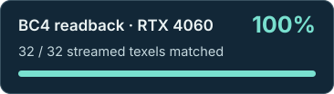

<h1 align="center">
  
</h1>

<p align="center"><strong>Native x86-64 runtime for Windows</strong></p>

<p align="center">
  <a href="https://github.com/tyr0nsur/PortVI/actions/workflows/windows.yml"></a>
  <a href="#build-and-run"></a>
  <a href="https://github.com/tyr0nsur/PortVI/issues"></a>
  <a href="LICENSE"></a>
</p>

<p align="center">
  <a href="#development-dashboard">Dashboard</a> ·
  <a href="#build-and-run">Build and run</a> ·
  <a href="#contribute">Contribute</a> ·
  <a href="docs/engineering-review.md">Engineering notes</a>
</p>

PortVI runs x86-64 console code directly on the Windows host CPU. Its engine is pinned directly to Marvisak’s VIctory. PortVI binds platform calls, translates console shaders to DXIL for Direct3D 12 and validates selected results on physical hardware. [Pinned engine](https://github.com/Marvisak/VIctory/commit/940d32f69b22265690a0b5a15d6ded572ba33baf)

## Development dashboard

The shader cards track one instruction, `v_med3_f32`. The texture cards track one authored 8×4 BC4 image and its skipped-upload control.

<!-- verification:start -->
<p align="center">
  <a href="probes/runtime.rs"></a>
  <a href="docs/engineering-review.md#reproduced-on-this-revision"></a>
  <a href="docs/engineering-review.md#bc4-storage-and-gpu-readback"></a>
  <a href="docs/engineering-review.md#bc4-storage-and-gpu-readback"></a>
  <a href="https://github.com/tyr0nsur/PortVI/issues/1"></a>
  <a href="https://github.com/tyr0nsur/PortVI/issues/3"></a>
</p>
<!-- verification:end -->

**Windows regression run** · On Windows x64, 731 Rust workspace tests and two frame-time analyzer tests passed on this engine revision. A separate source-built x64 probe binds both imports and returns exit status 73. [Test breakdown](docs/engineering-review.md#reproduced-on-this-revision)

**Texture streaming** · A DirectStorage request decoded two BC4 blocks directly into a console texture. The RTX 4060 matched all 32 texels after upload and detected all 32 stale texels when the upload was deliberately skipped. [Run the fixture](docs/engineering-review.md#bc4-storage-and-gpu-readback)

**Texture sampling** · The translator now emits DXIL for two instructions with 16-bit texture gradients. The RTX 4060 and WARP selected the expected mip levels and texels with both 16-bit and 32-bit coordinates. [G16 tests and supported forms](docs/engineering-review.md#g16-texture-sampling)

**Frame pacing** · The first scene benchmark needs paired 120-second captures with cold and warm caches. Stable 30 FPS remains unmeasured. [Capture protocol](docs/engineering-review.md#measuring-a-30-fps-target)

**Direct3D 12** · The RTX 4060 and WARP exposed different descriptor heap limits. PortVI uses the measured limit and the title-slot boundary when compiling and caching shaders. The device tests cover structured buffer reads, missing views and a direct index at that boundary. [Device checks and DXIL changes](docs/engineering-review.md#d3d12-descriptor-limits-and-dxil-validation)

## Build and run

Use Windows x64 with Git, Python 3.11+, Rust via rustup, and Visual Studio C++ Build Tools with a Windows SDK. The hardware check requires a physical Direct3D 12 adapter with Shader Model 6.6.

```powershell
git clone --recurse-submodules https://github.com/tyr0nsur/PortVI.git
cd PortVI
python portvi.py smoke
```

This builds `target\release\portvi.exe`, compiles the [open x64 probe](probes/runtime.rs) and executes it. A successful run prints `title exited with 73`. The wrapper checks that the process also returned 73.

| Command | What it checks |
| --- | --- |
| `python portvi.py test` | Full Rust workspace, including native CLI integration, shader, GPU, loader and storage tests, plus the frame-time analyzer. |
| `python portvi.py gpu` | Executes the median shader on the physical adapter and checks its outputs. |
| `python portvi.py texture` | Streams and samples the BC4 fixture on the physical GPU, then verifies the stale-content control. |
| `python portvi.py build` | Builds the release executable using the pinned engine and Cargo dependencies. |

<details>
<summary><strong>Inspect and run your own executable</strong></summary>

Set the path to an x64 console program you built or have permission to test. Inspect its imports, check which functions the runtime resolves, then enter the program.

```powershell
$program = 'D:\samples\sample.exe'
.\target\release\portvi.exe inspect $program --imports
.\target\release\portvi.exe census $program --missing
.\target\release\portvi.exe run $program
.\target\release\portvi.exe run $program --execute
```

The census counts runtime and Windows exports. For functions provided by a DLL alongside the program, use `inspect <library.dll> --exports` to compare its export table.

</details>

## Contribute

| Workstream | Next result we can verify | Join |
| --- | --- | --- |
| GPU validation | Repeat the 13 shader cases on AMD or Intel. Include the adapter, driver, commit and test output. | [Hardware reports](https://github.com/tyr0nsur/PortVI/issues/1) |
| Texture uploads | Repeat the BC4 readback and skipped-upload control on AMD or Intel. Record the device, driver and both counts. | [Texture fixture](https://github.com/tyr0nsur/PortVI/issues/2) |
| Frame pacing | Capture the same interactive scene twice and report displayed FPS and frame-time percentiles. | [Scene benchmark](https://github.com/tyr0nsur/PortVI/issues/3) |
| Synchronization | Verify fence wakeups on the pinned engine for CPU signals, GPU writes and direct memory writes. | [Fence waits](https://github.com/tyr0nsur/PortVI/issues/4) |

Public reproductions should use source and assets you can redistribute. For a hardware report, a comment on the tracking issue is enough.

<details>
<summary><strong>Work on an engine patch</strong></summary>

The `engine` submodule pins the upstream revision. `prepare` prints the path of a working tree with PortVI’s patches staged. Edit an existing engine file there, then export your unstaged change as the next numbered patch.

```powershell
$source = python portvi.py prepare
$patchPath = Join-Path $PWD 'patches/0012-description.patch'
git -C $source diff --output=$patchPath
python portvi.py test
```

</details>

<details>
<summary><strong>Update a dashboard result</strong></summary>

Add the reproducible result to the engineering notes or its tracking issue. Update the matching count in [verification.toml](docs/verification.toml) and run `python tools/render_progress.py`. CI checks that the committed cards and their accessible descriptions match the data.

</details>

## Credits and license

Marvisak and the VIctory contributors wrote the native engine. PortVI pins the original repository at `940d32f`. Earlier PortVI revisions used LooperSalty’s integration of fxceless’s fork. Their work informed the texture and depth-bounds changes carried forward here. PortVI’s changes and test tools are available under GPL-3.0-or-later. [Current engine](https://github.com/Marvisak/VIctory/commit/940d32f69b22265690a0b5a15d6ded572ba33baf) · [Earlier integration](https://github.com/LooperSalty/victory/commit/fd021bf26a7003749d668e5d9bf6b234bfab2e47) · [fxceless’s fork](https://github.com/fxceless/victory-fork) · [License](LICENSE)
